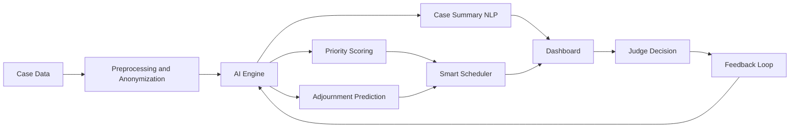

## Smart India Hackathon Workshop ^_^

> AI-Based Case Prioritization and Smart Scheduling for Courts

| | |
|---|---|
| **Reference Number** | 26019501 |
| **Name** | Parthiban S |
| **Date** | 02/11/26 |
| **Problem Title** | Court case backlogs and delays in the justice system |
| **Theme** | Smart Governance / Justice and Law (Criminology: Criminal Law and Justice Systems) |

---

## Problem Description

Indian courts carry crores of pending cases. Delays come from manual case listing, repeated adjournments, scattered records, and no data-driven way to decide which cases need urgent attention. Undertrial prisoners, victims, and the poor suffer the most.

**Expected solution:** a digital platform that
- Scores and prioritizes cases using AI.
- Predicts and reduces adjournments through smart scheduling.
- Gives judges, lawyers, police, and litigants one transparent dashboard.

---

##  Proposed Solution

### 1. Detailed Explanation
**NyayaFlow** is a web platform with four modules:

| Module | What it does |
|---|---|
| **Case Intake and Summarizer** | Reads FIRs, charge sheets, and orders (including regional languages) and extracts key facts, sections of law, and case stage |
| **Priority Scoring Engine** | Gives each case an urgency score using detention duration, offence severity, victim vulnerability, case age, and statutory time limits |
| **Smart Scheduler** | Predicts the likelihood of adjournment and suggests optimized hearing slots, balancing judge workload |
| **Stakeholder Dashboard** | Role-based views for judges, lawyers, police, and litigants |

### 2. How It Addresses the Problem
- Urgent cases (long-detained undertrials, vulnerable victims) surface first instead of waiting in queue order.
- Fewer wasted hearings through pre-hearing checks (documents ready, witness present, notices served).
- Faster reading of long case files through automated summaries.
- Transparency for litigants reduces unnecessary court visits.

### 3. Innovation and Uniqueness
- Combines prioritization, adjournment prediction, and scheduling in one system, whereas most tools only track status.
- **Explainable scores:** every priority shows *why* (for example "detained 14 months, offence bailable"), so the judge stays in control and the AI only assists.
- Multilingual support for Indian languages.
- Built-in fairness checks to avoid bias against any group.

---

##  Technical Approach

### 1. Technologies Used

| Layer | Tools |
|---|---|
| Frontend | React.js (or HTML, CSS, JavaScript) |
| Backend | Python, FastAPI / Flask, REST APIs |
| AI / ML | scikit-learn, XGBoost, spaCy, Hugging Face Transformers, Indic language models |
| Database | PostgreSQL, Redis |
| Security | Role-based access control, encryption, audit logs |
| Deployment | Docker, cloud or government data center |
| Data | Public NJDG / e-Courts data and anonymized synthetic data |

### 2. Methodology
1. Collect and anonymize case data (case type, filing date, hearings, adjournments, stage).
2. Clean data and engineer features (case age, detention days, hearing gaps).
3. Train the priority model and the adjournment-prediction model.
4. Build the NLP pipeline for case summaries.
5. Build the scheduler using constraint optimization for judge and court availability.
6. Integrate everything into the dashboard and test with sample cases.
7. Pilot in one district court, collect feedback, and improve.

### Workflow

---

##  Feasibility and Viability

### 1. Feasibility
- Technically feasible with proven ML and NLP tools.
- Builds on existing infrastructure (e-Courts, NJDG, CCTNS) instead of replacing it.
- Can start as a pilot in a single court and scale gradually.

### 2. Challenges and Risks
- Data privacy and sensitivity of case records.
- Poor data quality and inconsistent digitization.
- Judicial acceptance, since AI must not appear to replace judges.
- Algorithmic bias.
- Integration with existing systems and low digital literacy at lower courts.

### 3. Strategies to Overcome
- Anonymization, encryption, and strict access control.
- AI as an advisory tool only, with the final decision always with the judge.
- Explainable AI and regular bias audits.
- Open APIs for integration, plus training and a simple UI for court staff.
- Phased rollout: pilot, evaluate, expand.

---

##  Impact and Benefits

### 1. Impact on Target Audience
| Group | Impact |
|---|---|
| Judges and courts | Better listing, less time wasted, reduced backlog |
| Litigants and victims | Faster justice, fewer unnecessary visits |
| Undertrial prisoners | Quicker hearings for long-detained cases |
| Lawyers and police | Timely alerts, fewer adjournments |

### 2. Benefits
- **Social:** better access to justice, especially for the vulnerable.
- **Economic:** lower litigation costs and less lost wages from repeated court visits.
- **Administrative:** efficient use of judicial time and less prison overcrowding.
- **Environmental:** less paper and less travel.

---

##  Research and Resources (pending)
- [e-Courts Mission Mode Project](https://ecourts.gov.in)
- [National Judicial Data Grid (NJDG)](https://njdg.ecourts.gov.in)
- SUPACE: Supreme Court Portal for Assistance in Court Efficiency
- SUVAS: Supreme Court Vidhik Anuvaad Software
- CCTNS and ICJS, Ministry of Home Affairs
- Law Commission of India reports on court delays and judicial reforms
- Research papers on judicial analytics, adjournment prediction, and legal NLP

## Conclusion

CourtFlow12 uses AI to help courts decide which cases need attention first and to reduce wasted hearings. It supports judges rather than replacing them, keeping every decision with a human. By cutting delays, it can bring faster and fairer justice, especially for undertrial prisoners and victims humanrial prisoners.

---

