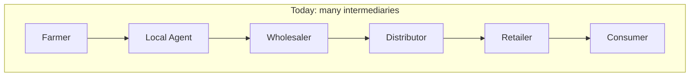
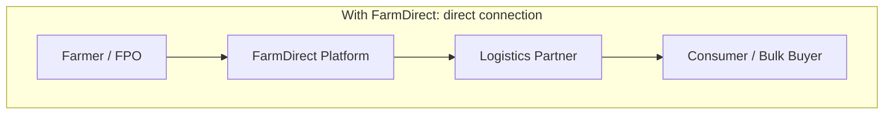
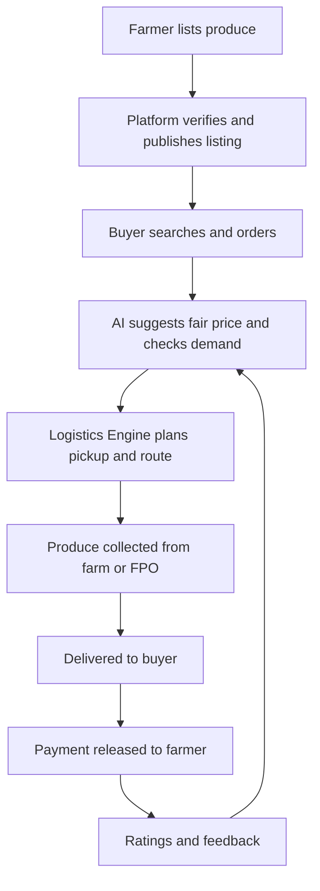
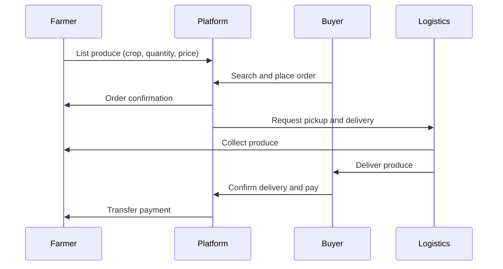
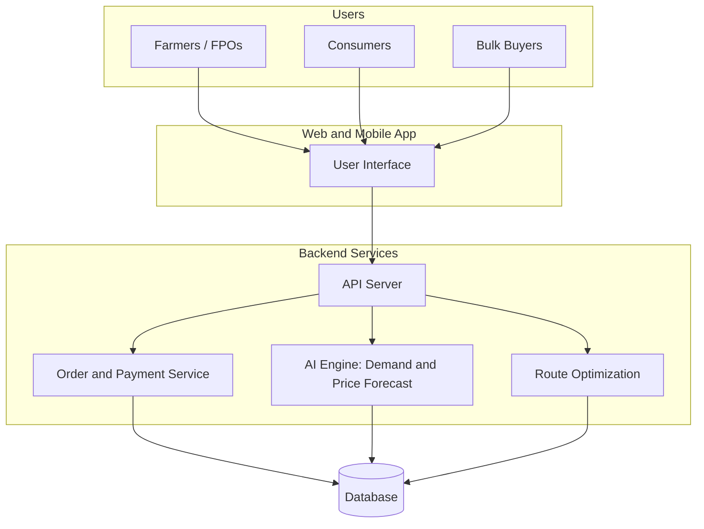

# Smart India Hackathon Workshop Submission 

> FarmDirect: A Digital Marketplace Connecting Farmers Directly to Buyers
| | |
|---|---|
| **Reference Number** | 26019501 |
| **Name** | Parthiban S |
| **Date** | 02/11/26 |
| **Problem ID** | SIH 26033 |
| **Problem Title** | Multiple intermediaries reduce farmers' earnings and increase consumer prices |
| **Organization** | Ministry of Consumer Affairs, Food & Public Distribution |
| **Theme** | Agriculture, FoodTech & Rural Development |

---

##  Problem Description

Farmers usually sell through several middlemen before produce reaches the consumer. Each one takes a cut, so farmers earn less while consumers pay more.

**Expected solution:** a digital marketplace that
- Connects farmers and FPOs (Farmer Producer Organizations) directly with consumers and bulk buyers.
- Provides logistics support.
- Uses AI for demand forecasting and route optimization.

**Benefits:**
- Better prices for farmers.
- Lower prices for consumers.
- Reduced supply chain inefficiencies.

---

##  The Problem vs. Our Solution

---

##  Proposed Solution

### 1. Detailed Explanation
**FarmDirect** is a mobile and web marketplace with five modules:

| Module | What it does |
|---|---|
| **Farmer / FPO Portal** | Farmers list produce with quantity, quality, price, and harvest date. Supports regional languages and simple voice or icon-based input |
| **Buyer Portal** | Consumers and bulk buyers (restaurants, hostels, retailers) browse, compare, and order directly |
| **AI Demand Forecasting** | Predicts which crops will be in demand and at what price, so farmers can plan what to grow and sell |
| **Logistics Engine** | Finds the best pickup, route, and delivery plan, and combines multiple orders into one trip |
| **Payments and Trust** | Secure digital payments straight to the farmer's bank account, plus ratings and quality checks |

### 2. How It Addresses the Problem
- **Fewer middlemen:** the farmer sells directly, so the middlemen's margin is reduced.
- **Better farmer income:** transparent pricing and direct payment.
- **Lower consumer prices:** fewer layers between farm and plate.
- **Less waste:** demand forecasting helps farmers sell perishable produce before it spoils.
- **Efficient delivery:** route optimization and shared trips reduce transport cost.

### 3. Innovation and Uniqueness
- Combines marketplace, AI forecasting, and logistics in a single platform.
- **FPO and bulk-buyer focus,** not just single consumers.
- **Price transparency:** shows the farmer's price and the delivery cost separately.
- **Simple for rural users:** regional languages, voice input, and low-data design.

---

##  How It Works

### Order Flow

---

##  Technical Approach

### 1. Technologies Used

| Layer | Tools |
|---|---|
| Frontend | React.js (web), React Native or Flutter (mobile) |
| Backend | Python with FastAPI / Flask, or Node.js, using REST APIs |
| AI / ML | scikit-learn, XGBoost, Prophet (demand and price forecasting) |
| Route Optimization | Google OR-Tools, Maps API |
| Database | PostgreSQL, Redis |
| Payments | UPI / payment gateway integration |
| Language Support | Regional language interface, voice input |
| Deployment | Docker, cloud hosting |

### 2. Architecture

### 3. Methodology
1. Collect data on crop prices, mandi rates, weather, and past demand.
2. Build the farmer and buyer apps with listing, search, and ordering.
3. Train forecasting models for demand and price.
4. Build route optimization to group orders and plan deliveries.
5. Integrate payments and ratings.
6. Pilot with one FPO and nearby buyers, collect feedback, and improve.

---

##  Feasibility and Viability

### 1. Feasibility
- Technically feasible with existing web, mobile, ML, and mapping tools.
- Smartphones and UPI are already widely used, even in rural areas.
- Can start with one crop and one region, then scale.

### 2. Challenges and Risks
- Low digital literacy among some farmers.
- Poor internet connectivity in rural areas.
- Cold storage and transport for perishable produce.
- Building trust between farmers and buyers.
- Quality consistency and grading of produce.

### 3. Strategies to Overcome
- Regional language, voice-based, and icon-based interface.
- Low-data and offline-friendly design.
- Partnering with FPOs and local village coordinators who help farmers onboard.
- Ratings, verified farmers, and quality checks.
- Starting with a pilot, then expanding.

---

## Overview

---

##  Impact and Benefits

| Group | Impact |
|---|---|
| Farmers / FPOs | Higher earnings, direct market access, better planning |
| Consumers | Fresher produce at lower prices |
| Bulk buyers | Reliable supply and transparent pricing |
| Rural economy | More income stays in villages, with new local jobs in logistics |

- **Social:** empowers small farmers and FPOs.
- **Economic:** better prices for farmers and lower prices for consumers.
- **Environmental:** less food waste and fewer wasted transport trips.

---

##  References and Resources
- [e-NAM (National Agriculture Market)](https://enam.gov.in)
- [Agmarknet (agricultural market prices)](https://agmarknet.gov.in)
- [Ministry of Consumer Affairs, Food & Public Distribution](https://consumeraffairs.nic.in)
- Government schemes supporting Farmer Producer Organizations (FPOs)
- ONDC (Open Network for Digital Commerce)

---

##  Conclusion

FarmDirect connects farmers and FPOs directly with consumers and bulk buyers, cutting out the layers of middlemen that reduce farmers' earnings and raise consumer prices. With AI demand forecasting, route-optimized logistics, and secure direct payments, the platform makes pricing more transparent and the supply chain more efficient. The result is better income for farmers, fresher and more affordable produce for consumers, and less food waste, supporting a stronger rural economy.

---

